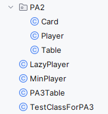

# COMP2056 Programming Assignment 3 - 6 nimmt! Inheritance

## 2026-27 Semester 1

* Designed by: [Dr. Kevin Wang](mailto:kevinw@comp.hkbu.edu.hk)
* Assignment Website: [GitHub](https://github.com/khwang0/COMP2056-2627PA3)
* Due: 
  * Programming Due: 11:59pm (Sunday midnight), 29th November, 2026
* Download the demo program: [here](demo.jar)
* Download everything from the assignment: [here](https://github.com/khwang0/COMP2056-2627PA3/archive/refs/heads/master.zip)
* Weighting: 6%

> To run the demo program, type the following in your terminal:
> 
> ```sh
> java -jar demo.jar
> ```


> Files to submit for the assignments:
> `LazyPlayer.java`, `MinPlayer.java`, and `Player.java` to Moodle.
> 
> However, you will need to modify the `Table.java` file to run your `LazyPlayer` and `MinPlayer` properly. You do not need to submit the modified `Table.java` file.


# Learning outcome

Students are expected to have some practices on object-oriented programming concepts/static variables/List/Inheritance/method visibility in this assignment. We expect most students would spend 5 hours to finish the assignment without any assistance. Make sure you start as earlier as possible and ask us on Discord if you have any difficulty!

> Important: You will use `ArrayList`, `List` this time.

---

# Requirements

In this project, you are going to refractor your PA2 code to meet the following requirements. 


1. New package `PA2`.

Move your PA2 code to a new package called `PA2`. You are required to change the package name in your PA2 code. 

2. Replace `hand` and `pile` arrays with `ArrayList` or `List` in the `Player` class.

In the `Player` class, you are required to replace the `hand` and `pile` arrays with an `ArrayList`. Because your list is dynamic, the field `handCount` need to be removed. 

3. Add a public method called `clear()` in the `Player`.

This method will empty the hand and pile of the player. You will use this method to reset the game for a new round.

4. Refactor the `Table` class according to the file `Table.java`

You need to 

1. Change the visibility of the `players` array to `protected`. 
2. Add a new method `public int getStacksCount(int index)` which has been provided to you already.
3. Refactor the constructor and break it down into the method `createPlayer()` and `dealCardsAndSetupStacks()`. 
 
 
However, you don't need to submit this file. Modifying this file allows you to run your `LazyPlayer` and `MinPlayer` properly.


5. Add a new class called `LazyPlayer`

`LazyPlayer` is a subclass of `Player`. It is a computer controlled player which does not require any user input. It has the following strategy:
* `LazyPlayer` will always play the card with the smallest number in its hand.
* When `LazyPlayer` needs to choose a stack, it will always choose the stack with the smallest number of bullheads/scores. If there are multiple stacks with the same number of bullheads, it will choose any of them (your choice).

A `LazyPlayer` has a default constructor. The name of the first created `LazyPlayer` is called "Lazy Player 1". The second one is called "Lazy Player 2", and so on. 

6. Add a new class called `MinPlayer`

A `MinPlayer` is also a subclass of `Player`. It has the following strategy

* `MinPlayer` has its own way to play card. Please refer to `MinPlayer.java`.
* When `MinPlayer` needs to choose a stack, it will always choose the stack with the smallest number of bullheads/scores. If there are multiple stacks with the same number of bullheads, it will choose any of them (your choice).

A `MinPlayer` has a constructor that takes a `Table` object as parameter. The name of the first created `MinPlayer` is called "Min Player 1". The second one is called "Min Player 2", and so on.


After finishing the above requirements, you can run the program `PA3Table` to test your program. Your file structure should look like:




> Note: `Table` class provides only limited information for `MinPlayer` and `LazyPlayer` for implementation. The variables `stacks`, `stacksCount`, and `players` are not shared directly, because `MinPlayer` and `LazyPlayer` are not in the same package as `Table`. Information about stacks can be accessed through the method `getStacksCount(int index)` and `findStackToAdd(Card card)` only.

# Extra

You can optionally create your own subclass of Player which has its own strategy to play the game. Your class should have a constructor that takes a `Table` object as parameter. 

By submitting your own subclass of Player, your class will be tested in the simulator against other student's Player in `Simulator.java`. The simulator will run your class with other student's class for 100 times. The ultimate winner will enter the hall of fame which students in the next year will see it.


No extra marks will be given for this part. 

> To test your class, you can visit the simulator website and upload your class (and perhaps your classmates' class) to see how your class performs.
> Website: https://comp2056pa3runner.khwang0.hkbu.app/
>
> To enter the contest, you have to make sure your class win against the default `LazyPlayer` and `MinPlayer` in the simulator. i.e., having a lower total score than them.


---


# Submission 
For submission upload the file `LazyPlayer.java`, `MinPlayer.java`, and `Player.java` to Moodle.  


## Marking Scheme 

* 40% - if your programme can be compiled and run without any error.
* 40% - pass all test cases given in TestClassForPA3.java
* 20% - pass the remaining test cases.

If your program fail to compile as a whole, but your MinPlayer can be compiled on the website after (after renaming the class as `MyPlayer`). You will receive 40% for the whole assignment.   

 

## Interview 
Should the teaching team see fit, students may be requested to attend an interview to explain about their program.  Students failing to attend such interview or to demonstrate a good understanding of their own program may result in mark deduction. 


